<div align="center">

# 🏋️ FitForge – Plateforme de gestion de salle de sport

**Application web fullstack complète : site vitrine, espace membre, espace coach, accueil (réception) et back-office administrateur, avec assistants IA et check-in par reconnaissance faciale.**


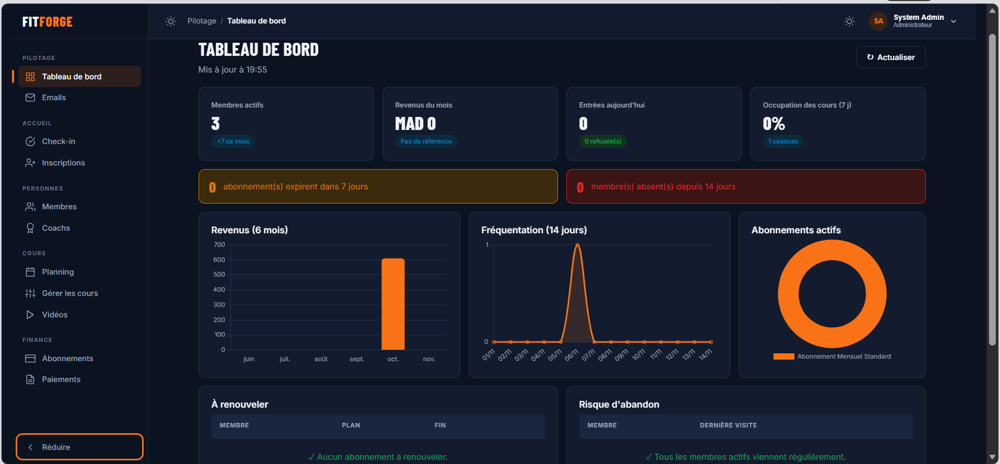

</div>

---

## 📑 Sommaire

1. [Présentation](#-présentation)
2. [Aperçu de l'application](#-aperçu-de-lapplication)
3. [Fonctionnalités par profil](#-fonctionnalités-par-profil)
4. [Parcours d'un participant](#-parcours-dun-participant)
5. [Architecture](#-architecture)
6. [Technologies et dépendances](#-technologies-et-dépendances)
7. [Backend en détail](#-backend-en-détail)
8. [Validation des données](#-validation-des-données)
9. [Lombok](#-lombok)
10. [Sécurité](#-sécurité)
11. [Base de données MySQL](#-base-de-données-mysql)
12. [Frontend Angular en détail](#-frontend-angular-en-détail)
13. [Assistants IA](#-assistants-ia)
14. [Reconnaissance faciale](#-reconnaissance-faciale)
15. [Emails automatiques](#-emails-automatiques)
16. [Règles métier](#-règles-métier)
17. [Structure du projet](#-structure-du-projet)
18. [Installation](#-installation)
19. [Configuration](#-configuration)
20. [Tests](#-tests)
21. [Tests API avec Postman](#-tests-api-avec-postman)
22. [Référence des endpoints](#-référence-des-endpoints)
23. [Feuille de route](#-feuille-de-route)
24. [Auteur](#-auteur)

---

## 🎯 Présentation

**FitForge** gère toute la vie d'une salle de sport, de la première visite d'un visiteur jusqu'au suivi quotidien de ses adhérents.

Le projet répond à quatre besoins réels d'un gérant de salle :

| Besoin | Réponse de l'application |
|---|---|
| **Attirer et inscrire** | Site public (cours, coachs, tarifs, exercices) et inscription en ligne avec choix de l'abonnement et du coach |
| **Encaisser et contrôler l'accès** | Vente d'abonnements, reçus PDF, check-in par QR code, code-barres ou visage |
| **Organiser les cours** | Cours récurrents, séances, réservations, liste d'attente, annulations |
| **Piloter et fidéliser** | Tableau de bord, relances automatiques par email, assistant IA d'analyse |

L'objectif technique est de montrer une application **complète, sécurisée et testée**, construite sur une architecture en couches propre, avec des migrations de base de données versionnées et un déploiement Docker.

---

## 🖼️ Aperçu de l'application

### Tableau de bord administrateur
Indicateurs animés (membres actifs, revenus, entrées du jour, occupation des cours), graphiques des revenus sur 6 mois, de la fréquentation sur 14 jours et de la répartition des abonnements, listes « À renouveler » et « Risque d'abandon ».


### Inscription en ligne
Le visiteur crée son compte, choisit un abonnement et un coach. Le compte **et** la fiche membre sont créés ensemble, un email de bienvenue est envoyé.

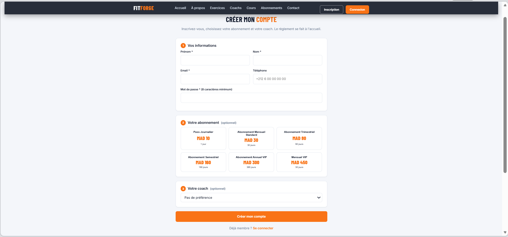

### Gestion des membres
Recherche instantanée, filtre par statut, fiche détaillée avec QR code, code-barres, historique des abonnements et reçus.

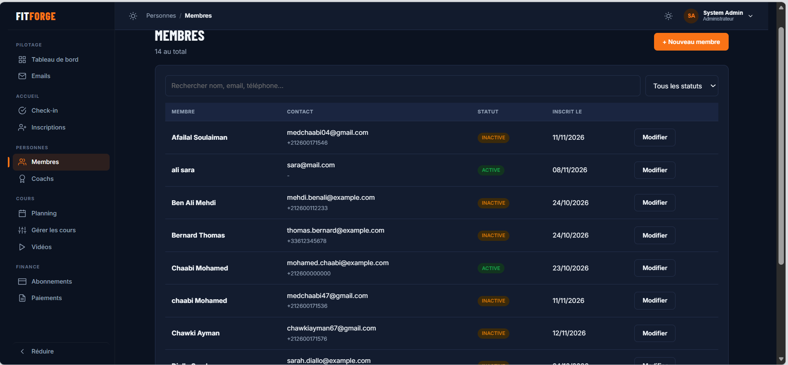

### Check-in à l'entrée
Trois façons d'entrer : QR code, code-barres, ou reconnaissance faciale. Le visage **propose** un membre, la réception **confirme** : les règles (abonnement expiré, gelé, doublon) s'appliquent toujours.

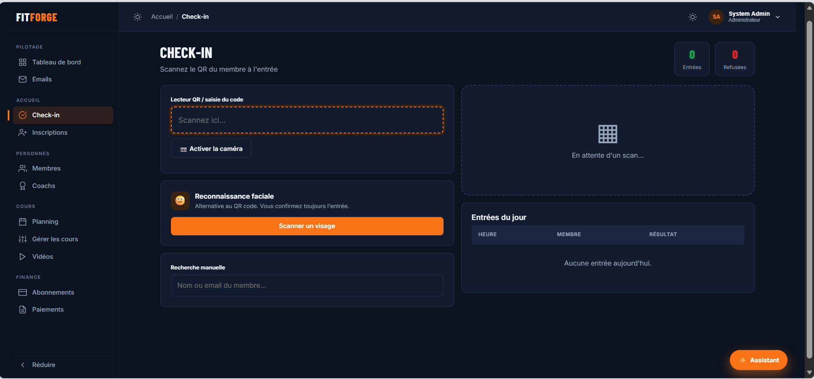

### Assistant IA de réservation (membre)
Le membre écrit « un cours de cardio le soir » et reçoit jusqu'à 3 séances réelles à confirmer.

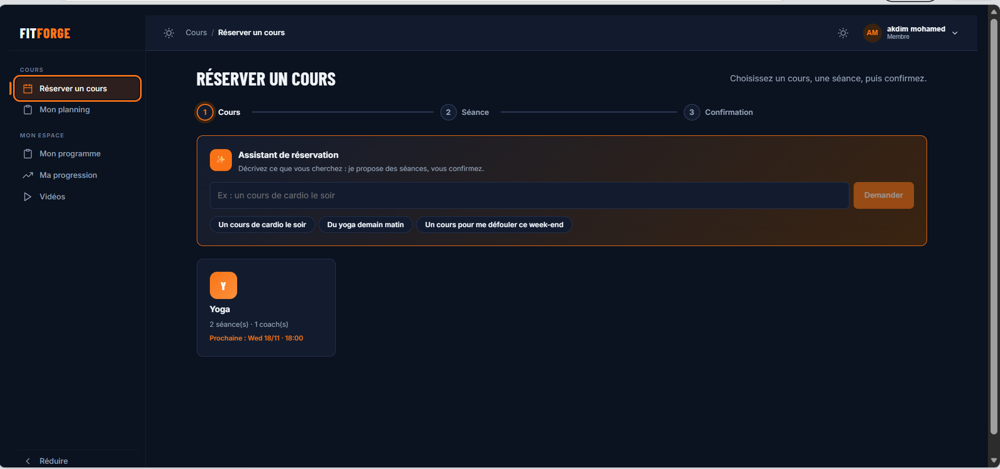

### Assistant IA d'analyse (administrateur)
Répond aux questions chiffrées, analyse l'activité et explique comment utiliser l'application. Chaque conclusion affiche les **vrais chiffres** issus de la base.

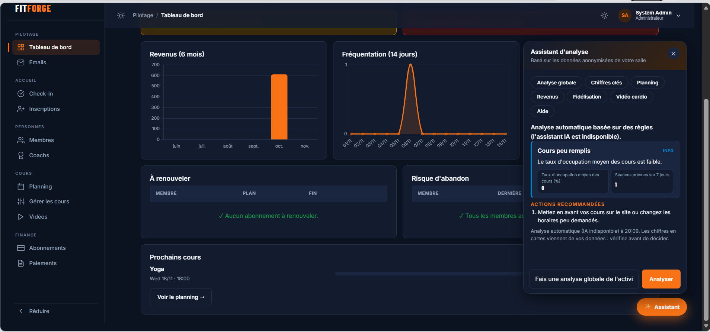

### Bibliothèque de vidéos
Vidéos YouTube ou fichiers importés depuis l'ordinateur, filtrées par catégorie.

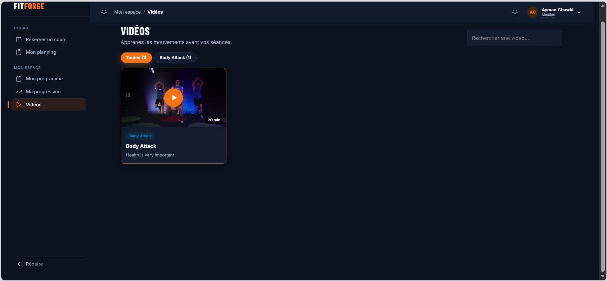

### Planning des cours
Vue hebdomadaire, participants par séance, ajout d'un membre, annulation avec prévenance par email.

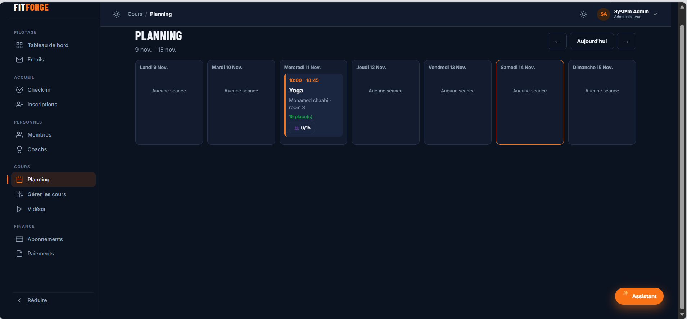

### Abonnements et paiements
Création et activation des offres, paiement en espèces, carte ou virement, reçu PDF numéroté.

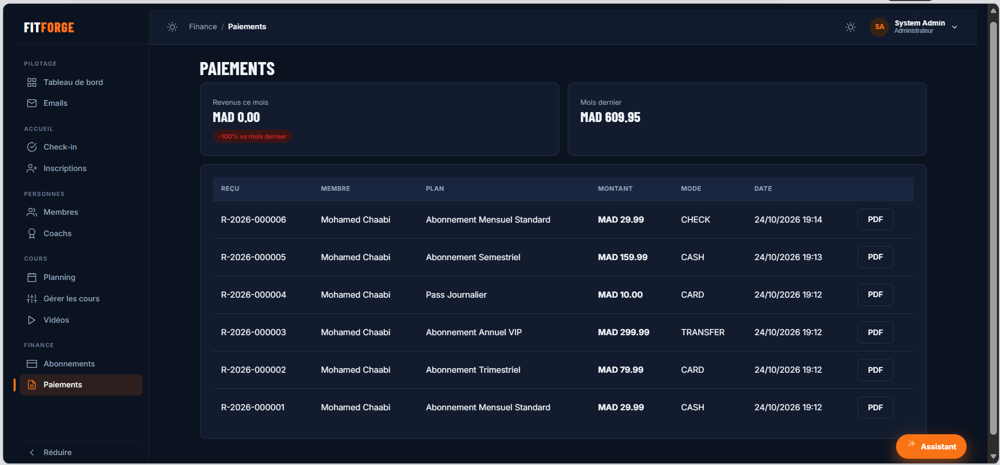

### Site public
Page d'accueil, exercices, coachs, planning et tarifs visibles sans connexion.

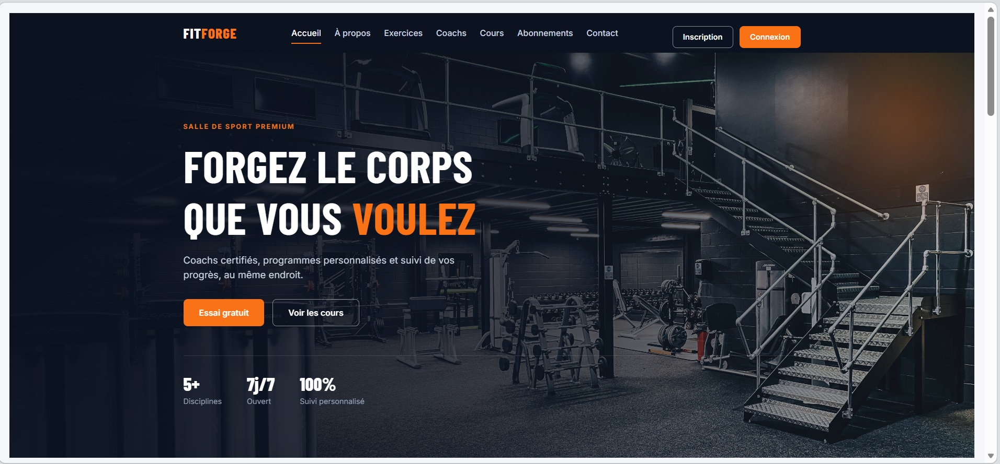

> 🎬 Une présentation animée des écrans est disponible dans l'application à l'adresse `/demo`.

---

## ✨ Fonctionnalités par profil

### 🌐 Visiteur
- Pages : accueil, à propos, exercices, coachs, cours, abonnements, contact
- **Fiche exercice** en fenêtre : objectif, muscles travaillés, étapes numérotées, et cours à venir liés à l'exercice
- Planning public avec places libres en direct
- Formulaire de contact validé côté client et côté serveur
- **Inscription en ligne** avec choix de l'abonnement et du coach

### 🙋 Membre
- Accueil : progression de l'abonnement, coach, carte d'accès (QR code), programmes
- **Assistant de réservation** en 3 étapes : cours, séance, confirmation
- Liste d'attente avec promotion automatique si une place se libère
- Annulation possible jusqu'à 2 heures avant le cours
- Suivi des mesures (poids, masse grasse, taille, poitrine, bras) avec courbes
- Vidéos de démonstration, programmes d'entraînement

### 🏅 Coach
- Liste de ses clients, suivi de progression de chacun
- Création de programmes d'entraînement, avec **génération d'un brouillon par IA** relu et modifié par le coach
- Planning et vidéos

### 🛎️ Réception
- Check-in (QR code, code-barres, recherche manuelle, visage)
- Inscriptions en attente de règlement : l'abonnement choisi est pré-sélectionné, le coach souhaité est assigné automatiquement à l'encaissement
- Gestion des membres et du planning

### 👑 Administrateur
- Tableau de bord complet et assistant d'analyse IA
- Membres, coachs, abonnements, paiements, reçus PDF
- Cours récurrents et séances ponctuelles
- Bibliothèque de vidéos avec import de fichiers
- File d'envoi des emails (statuts, relance des échecs)

---

## 🧭 Parcours d'un participant

```mermaid
flowchart LR
    A[Visiteur<br/>consulte coachs, cours, tarifs] --> B[Inscription en ligne<br/>compte + abonnement + coach]
    B --> C[Email de bienvenue<br/>connexion automatique]
    C --> D[Règle l'abonnement<br/>à l'accueil]
    D --> E[Abonnement ACTIF<br/>coach assigné<br/>email de confirmation]
    E --> F[Réserve des cours<br/>assistant IA ou assistant en 3 étapes]
    F --> G[Entre à la salle<br/>QR code, code-barres ou visage]
    G --> H[Suit sa progression<br/>programmes, mesures, vidéos]
    H --> I[Relances automatiques<br/>renouvellement, inactivité]
```

**Qui voit quoi après connexion ?**

| Profil | Page d'arrivée | Accès interdit |
|---|---|---|
| Visiteur | `/home` | Toutes les pages privées (redirection vers `/login`) |
| Membre sans abonnement | `/member/home` avec une checklist en 4 étapes | `/member/book` jusqu'au règlement |
| Membre actif | `/member/home` | Pages du personnel |
| Coach | `/coach/clients` | Pages admin et membre |
| Réception | `/reception/checkin` | Tableau de bord et finances |
| Admin | `/admin/dashboard` | Aucun |

Une adresse inconnue affiche une page 404, un rôle non autorisé est renvoyé vers son propre espace.

---

## 🏛️ Architecture

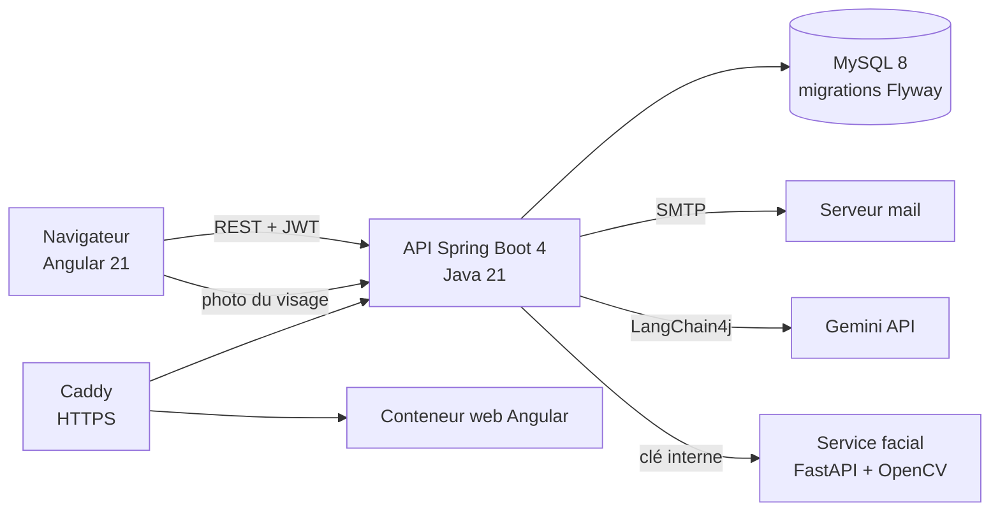

**Architecture en couches du backend**

```
Controller  ->  Service  ->  Repository  ->  Entity (MySQL)
   |              |
   |              +--> règles métier, transactions, envoi d'emails, IA
   +--> validation des requêtes (DTO records), sécurité (@PreAuthorize)
```

- Les **contrôleurs** exposent l'API REST et ne contiennent aucune règle métier.
- Les **services** portent les règles métier et les transactions.
- Les **repositories** (Spring Data JPA) isolent les requêtes, avec des `join fetch` pour éviter le problème N+1.
- Les **DTO** sont des `record` Java immuables, jamais les entités directement.

---

## 🧰 Technologies et dépendances

### ⚙️ Backend (`fitnessBackEnd/pom.xml`)

| Domaine | Technologie | Rôle dans le projet |
|---|---|---|
| Langage | **Java 21** | Records, streams, lambdas, switch expressions |
| Build | **Maven** + Maven Wrapper 3.9.12 | Build reproductible sans installer Maven |
| Framework | **Spring Boot 4.0.2** | Socle de l'application |
| Web | `spring-boot-starter-webmvc` | API REST |
| Persistance | `spring-boot-starter-data-jpa` (Hibernate) | Entités, repositories, requêtes JPQL |
| Driver | `mysql-connector-j` | Connexion MySQL |
| Migrations | `spring-boot-starter-flyway` + `flyway-mysql` | Schéma versionné (V1 à V9) |
| Validation | `spring-boot-starter-validation` | Jakarta Bean Validation (JSR 380) |
| Sécurité | `spring-boot-starter-security` | Authentification, autorisations, en-têtes de sécurité |
| JWT | `jjwt-api`, `jjwt-impl`, `jjwt-jackson` 0.12.6 | Jetons d'accès signés |
| Boilerplate | **Lombok** | Getters, setters, builders, constructeurs, logs |
| Email | `spring-boot-starter-mail` | Envoi SMTP |
| Gabarits | `spring-boot-starter-thymeleaf` | Email HTML |
| Supervision | `spring-boot-starter-actuator` | Endpoint `/actuator/health` |
| IA | `langchain4j` 1.0.1, `langchain4j-google-ai-gemini` | Appels au modèle Gemini avec sorties structurées |
| Agents | `langgraph4j-core` 1.6.0 | Graphe avec boucle de correction |
| Codes | `zxing core` + `javase` 3.5.3 | QR code et code-barres Code 128 |
| PDF | `openpdf` 1.3.43 | Reçus de paiement |
| Confort | `spring-boot-devtools` | Rechargement en développement |
| Tests | `spring-boot-starter-*-test`, **Testcontainers (MySQL)** | Tests d'intégration sur un vrai MySQL |

### 🎨 Frontend (`Fitness/`)

| Domaine | Technologie |
|---|---|
| Framework | **Angular 21**, composants **standalone** |
| État | **Signals** (`signal`, `computed`, `effect`, `input`, `output`) |
| Gabarits | Nouveau contrôle de flux `@if`, `@for`, `@switch` |
| Injection | `inject()` |
| Formulaires | **Reactive Forms** avec validateurs |
| HTTP | `HttpClient` + `withFetch()` + intercepteur fonctionnel |
| Routage | Chargement différé (`loadComponent`), guards fonctionnels, titres de page, transitions de vue |
| Rendu | **Angular SSR** (`@angular/ssr`, Express) |
| Graphiques | **Chart.js** |
| Scan caméra | **html5-qrcode** |
| Style | CSS pur avec variables (design tokens), thème sombre |
| Langage | **TypeScript** fortement typé (interfaces pour chaque DTO) |
| Tests | Lanceur de tests Angular (`ng test`) |

### 🐍 Service de reconnaissance faciale (`face-service/`)

| Domaine | Technologie |
|---|---|
| Langage | Python 3.12 |
| API | **FastAPI** 0.115, **Uvicorn** 0.32, `python-multipart` |
| Vision | **OpenCV** 4.10 (headless), **NumPy** 1.26 |
| Modèles | **YuNet** (détection) et **SFace** (empreinte du visage), issus d'OpenCV Zoo |

### 🐳 Infrastructure

| Domaine | Technologie |
|---|---|
| Conteneurs | Docker, Docker Compose (`db`, `backend`, `web`, `face`) |
| Proxy | **Caddy** (HTTPS automatique) |
| Base | **MySQL 8.0** |
| Email en développement | Mailtrap (SMTP sandbox) |

---

## ⚙️ Backend en détail

### Organisation des packages
```
com.example.fitnessBackEnd
├── controller/    API REST (Auth, Member, Coach, Class, Payment, CheckIn, Video, Agent...)
├── service/       règles métier, jobs planifiés, IA, emails
├── repository/    interfaces Spring Data JPA
├── entity/        entités JPA
├── dto/           records de requête et de réponse
├── mapper/        conversion entité vers DTO
├── enums/         Role, MemberStatus, BookingStatus, EmailType...
├── config/        SecurityConfig, CorsConfig, SchedulingConfig
└── exception/     exceptions métier + GlobalExceptionHandler
```

### Gestion centralisée des erreurs
Un seul `@RestControllerAdvice` transforme chaque exception en réponse JSON propre :

| Code | Cas |
|---|---|
| 400 | Validation échouée, requête illisible, règle métier |
| 401 | Non authentifié ou identifiants invalides |
| 403 | Rôle insuffisant |
| 409 | Conflit (email déjà utilisé, séance annulée, service indisponible) |
| 429 | Trop de tentatives, avec l'en-tête `Retry-After` |
| 500 | Erreur interne : le détail est écrit dans les logs, le client reçoit seulement une référence |

### Tâches planifiées (`@Scheduled`)
| Heure | Tâche |
|---|---|
| Chaque heure | Rappels des cours du lendemain |
| 00:05 | Passage des abonnements terminés à `EXPIRED` |
| 01:30 | Génération des séances à partir des cours récurrents (28 jours) |
| 03:15 | Purge des jetons de rafraîchissement expirés |
| 09:00 | Email « abonnement bientôt terminé » |
| 10:00 | Email aux membres inactifs |
| 11:00 | Rappel aux inscriptions non réglées depuis 48 h |
| Toutes les 15 s | Envoi des emails en attente |

### Concurrence : réservation d'une même place
La réservation verrouille la ligne de la séance (`PESSIMISTIC_WRITE`). Dix personnes qui réservent **en même temps** la dernière place donnent exactement **un** confirmé et neuf en liste d'attente. Ce comportement est couvert par un test d'intégration.

---

## ✅ Validation des données

Toutes les requêtes passent par des DTO validés avec **Jakarta Bean Validation (JSR 380)**. Une erreur renvoie un JSON `champ : message`, lu directement par les formulaires Angular.

```java
public record RegisterRequest(
        @NotBlank @Size(max = 50) String nom,
        @NotBlank @Size(max = 50) String prenom,
        @NotBlank @Email @Size(max = 100) String email,
        @NotBlank @Size(min = 8, max = 72) String motDePasse,      // 72 = limite réelle de BCrypt
        @Pattern(regexp = "^[+0-9 ()-]{6,20}$", message = "Téléphone invalide") String phone,
        Long planId, Long coachId) {}
```

| Annotation | Utilisation dans le projet |
|---|---|
| `@NotBlank`, `@NotNull`, `@NotEmpty` | Champs obligatoires |
| `@Size` | Longueurs (noms, descriptions, mots de passe, listes) |
| `@Email` | Adresses email |
| `@Pattern` | Téléphone |
| `@Min`, `@Max` | Séries, répétitions, capacité, durée, jours de la semaine |
| `@DecimalMin`, `@DecimalMax`, `@Digits` | Mesures corporelles, prix |
| `@Past`, `@PastOrPresent`, `@FutureOrPresent` | Dates de naissance, de mesure, de séance |
| `@Valid` | Validation des éléments imbriqués (lignes d'un programme) |

La validation est répétée dans **Angular** (`Validators.required`, `email`, `minLength`, `pattern`) pour un retour immédiat, mais le serveur reste la référence.

Autres contrôles : le type réel d'un fichier envoyé est vérifié sur son **contenu** (pas son extension), les prix sont toujours lus côté serveur, et les liens YouTube sont analysés puis réduits à un identifiant de 11 caractères.

---

## 🧩 Lombok

Lombok supprime le code répétitif des entités et des services.

```java
@Entity
@Table(name = "subscriptions", indexes = @Index(columnList = "member_id, status"))
@Getter @Setter
@NoArgsConstructor @AllArgsConstructor
@Builder
public class Subscription { ... }
```

| Annotation | Où | Pourquoi |
|---|---|---|
| `@Getter`, `@Setter` | Entités | Accès aux champs sans écrire les méthodes |
| `@NoArgsConstructor` | Entités | Constructeur sans argument exigé par JPA |
| `@AllArgsConstructor`, `@Builder` | Entités | Création lisible : `Member.builder().firstName(...).build()` |
| `@RequiredArgsConstructor` | Services, contrôleurs | **Injection par constructeur** des dépendances `final` |
| `@Slf4j` | Services, jobs | Logger prêt à l'emploi |

---

## 🔐 Sécurité

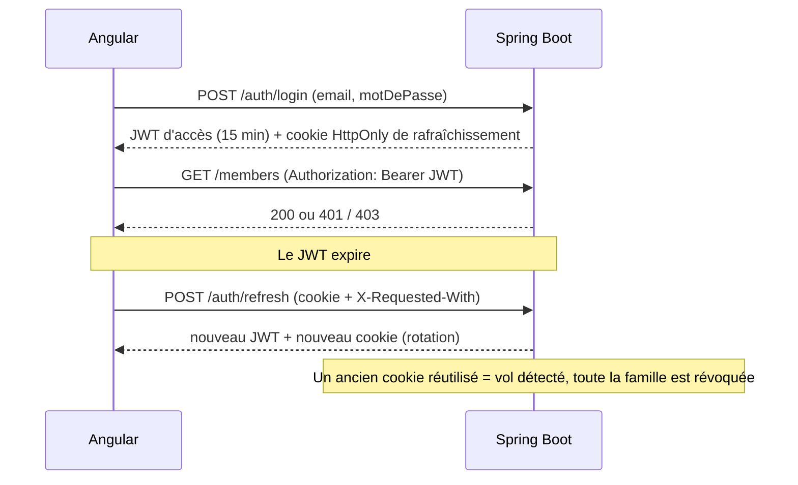

| Mesure | Détail |
|---|---|
| **JWT** | Jeton d'accès de 15 minutes, signé HMAC, rôle dans les claims |
| **Refresh token** | Cookie `HttpOnly`, `SameSite=Strict`, stocké **haché** (SHA-256), rotation à chaque usage, détection de réutilisation avec révocation de toute la chaîne, tolérance de quelques secondes pour les onglets simultanés |
| **Mots de passe** | **BCrypt** (force 12), vérification en temps constant : le temps de réponse ne révèle pas si un email existe |
| **Anti force brute** | Verrouillage de 15 minutes après 5 échecs (par compte et par IP), limite d'inscriptions par IP |
| **Autorisations** | Rôles `ADMIN`, `RECEPTION`, `COACH`, `MEMBER`, `@PreAuthorize` sur chaque endpoint, guards Angular en plus |
| **En-têtes HTTP** | Content-Security-Policy, HSTS, `X-Frame-Options` refusé, `Referrer-Policy: no-referrer` |
| **CORS** | Liste d'origines autorisées, configurée par variable d'environnement |
| **CSRF** | Désactivé car aucun cookie n'authentifie les appels API (le jeton est dans l'en-tête) ; la route de rafraîchissement exige en plus un en-tête personnalisé |
| **Désabonnement email** | Lien signé HMAC-SHA256, comparaison en temps constant |
| **Données** | Aucune stack trace envoyée au client, journaux sans email complet |
| **IA** | Données anonymes uniquement, sorties validées, quotas quotidiens |

---

## 🗄️ Base de données MySQL

Le schéma est géré par **Flyway** (`src/main/resources/db/migration`). Chaque évolution est une migration versionnée, jamais une modification manuelle.

| Migration | Contenu |
|---|---|
| `V1__baseline` | Utilisateurs, coachs, membres, abonnements, paiements, check-ins, cours, séances, réservations, exercices, programmes, mesures, contacts, file d'emails, jetons |
| `V2__agent_runs` | Journal et quotas des assistants IA |
| `V3__enrollment_requests` | Demandes d'inscription en ligne |
| `V4__videos` | Bibliothèque de vidéos |
| `V5__email_types` | Emails de bienvenue et de paiement confirmé |
| `V6__exercice_details` | Objectif, muscles, étapes et mots-clés des exercices |
| `V7__face_templates` | Empreintes faciales avec date de consentement |
| `V8__payment_reminder` | Email de rappel de paiement |
| `V9__video_uploads` | Affiche des vidéos importées |

### Modèle de données

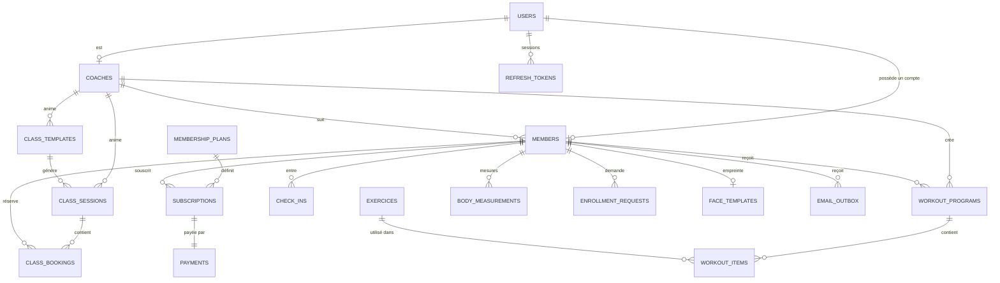

### Choix de conception
- **Contraintes d'unicité** : un email par utilisateur, un QR code par membre, un paiement par abonnement, une réservation par couple séance/membre, une mesure par membre et par jour, un seul modèle de cours par jour et par séance.
- **Index** sur les colonnes filtrées (`member_id, status`, `session_date`, `status, next_attempt_at`).
- **Historique conservé** : un membre n'est jamais supprimé mais désactivé, afin de garder paiements et accès.
- **Prix figé** : changer le prix d'un abonnement ne modifie pas les abonnements déjà vendus.
- **Reçu numéroté** : `R-2026-000123`.

---

## 🎨 Frontend Angular en détail

### Organisation
```
Fitness/src/app
├── core/        auth, intercepteur, guards, thème, directives, titres, dates
├── data/        modèles TypeScript et services HTTP par domaine
├── features/    public, auth, member, coach, reception, admin, schedule, progress
├── layouts/     mise en page publique et mise en page tableau de bord
└── shared/      caméra du visage, assistant IA, analyse de vidéo
```

### Routage
```
/                     site public (accueil, exercices, coachs, tarifs, planning, contact, inscription)
/login                connexion (invités seulement)
/demo                 présentation animée
/espace               envoie chacun vers son accueil selon son rôle
/member/*             MEMBER      (réservation réservée aux abonnements actifs)
/coach/*              COACH
/reception/*          ADMIN, RECEPTION
/admin/*              ADMIN, RECEPTION (certaines pages réservées à ADMIN)
**                    page 404
```
Toutes les pages privées sont chargées à la demande (*lazy loading*) et protégées par des **guards fonctionnels**.

### Authentification côté client
Un **intercepteur HTTP** ajoute le jeton, et si une requête reçoit un 401, tente **un seul rafraîchissement partagé** par toutes les requêtes en cours avant de renvoyer vers la connexion. Le jeton n'est envoyé qu'à l'API de l'application, jamais à un tiers.

### Interface et animations
- Mise en page **dashboard** : barre latérale rétractable, fil d'Ariane, menu utilisateur, thème clair/sombre
- Animations : transition de page, apparition en cascade des cartes, apparition au défilement, compteurs animés, graphiques animés, indicateur d'étapes, coche de succès
- **Accessibilité** : navigation clavier, `aria-*`, focus visible, et respect de `prefers-reduced-motion`
- **Responsive** : menu tiroir, tableaux transformés en cartes sur téléphone, fenêtres en bas d'écran
- Fenêtres natives `<dialog>` avec blocage du défilement en CSS pur

### Composants réutilisables
| Élément | Usage |
|---|---|
| `[reveal]` | Apparition au défilement |
| `[countUp]` | Nombre qui s'incrémente |
| `<app-face-camera>` | Caméra avec guide de cadrage, utilisée à l'enregistrement et au check-in |
| `<app-assistant>` | Panneau de l'assistant d'analyse |
| `probeVideo()` | Lit la durée et capture une affiche d'une vidéo, dans le navigateur |

---

## 🤖 Assistants IA

Tous les assistants utilisent **Google Gemini via LangChain4j** et respectent les mêmes principes de sûreté :

1. **Le modèle ne lit jamais la base de données.** Il reçoit uniquement des faits préparés par le backend, anonymes.
2. **Le backend valide la réponse** : identifiants inventés supprimés, texte nettoyé, conclusions obligées de citer de vraies métriques.
3. **Un mode de secours** sans IA répond quand le service est indisponible.
4. **Le texte de l'utilisateur est une donnée**, pas une instruction : limité en longueur et nettoyé.
5. **Quota quotidien** par utilisateur, journalisé dans `agent_runs`.

| Assistant | Pour | Fonctionnement |
|---|---|---|
| Générateur de programme | Coach | Brouillon hebdomadaire passé dans un graphe **LangGraph4j** : génération, validation (exercices réels, volume réaliste, jours demandés), nouvel essai avec les erreurs en retour, abandon après 3 essais |
| Rédacteur d'emails | Système | Un court paragraphe par email, refusé s'il contient chiffre, lien ou HTML |
| Assistant de réservation | Membre | Propose jusqu'à 3 séances réelles ; l'IA ne renvoie que des identifiants |
| Analyste | Admin | Questions chiffrées, analyses et aide à l'utilisation, avec les chiffres réels affichés à côté de chaque conclusion |

Les consignes sont écrites dans des fichiers `src/main/resources/prompts/*.txt`, modifiables sans recompiler.

---

## 🙂 Reconnaissance faciale

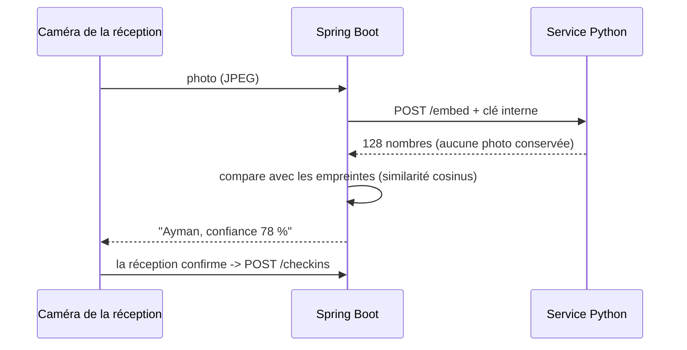

- Le service Python est **sans état** : il convertit une photo en nombres et ne stocke rien.
- Spring conserve seulement l'**empreinte** (jamais la photo), avec la date de consentement et la personne qui l'a enregistrée.
- Un membre est proposé si le score dépasse un seuil **et** s'il devance nettement le deuxième candidat.
- Le visage **identifie** seulement : abonnement expiré, gelé ou doublon sont toujours refusés. QR code et code-barres restent disponibles.
- Fonction **désactivée par défaut** (`FACE_ENABLED=false`).

> ⚠️ Une donnée biométrique est sensible. Avant une utilisation réelle, recueillir le consentement écrit de chaque membre et vérifier la réglementation locale (par exemple la CNDP au Maroc).

---

## 📧 Emails automatiques

Les emails passent par une **file d'envoi** (modèle *outbox*) : ils sont enregistrés en base, puis envoyés par une tâche, ce qui évite de perdre un message si le serveur mail est indisponible.

| Email | Déclencheur | Type |
|---|---|---|
| Bienvenue | Inscription | Transactionnel |
| Paiement confirmé | Encaissement | Transactionnel |
| Place confirmée | Liste d'attente promue | Transactionnel |
| Cours annulé | Annulation par l'admin | Transactionnel |
| Rappel de cours | La veille | Optionnel |
| Abonnement bientôt terminé | 7 jours avant | Campagne |
| Relance d'inactivité | 14 jours sans venir | Campagne |
| Rappel de paiement | 48 h sans règlement | Campagne |

Fonctionnement :
- **Reprise automatique** avec attente croissante (2, 4, 8 minutes...), puis abandon après 5 essais
- **Une seule fois** par événement grâce à une clé de déduplication
- **Une campagne maximum tous les 3 jours** par membre
- **Désabonnement en un clic** dans chaque email optionnel
- Gabarit HTML Thymeleaf aux couleurs de la marque, avec version texte
- Paragraphe rédigé par l'IA, ou texte fixe de secours, indiqué dans l'administration

---

## 📏 Règles métier

| Règle | Valeur |
|---|---|
| Durée du jeton d'accès | 15 minutes |
| Échecs de connexion avant verrouillage | 5, verrouillage 15 minutes |
| Doublon de check-in | Même membre dans les 5 minutes |
| Alerte de fin d'abonnement | 7 jours |
| Membre à risque | 14 jours sans entrée |
| Annulation d'une réservation | Jusqu'à 2 heures avant le cours |
| Séances générées à l'avance | 28 jours |
| Renouvellement d'un abonnement encore valide | Le nouveau commence le lendemain de la fin du précédent |
| Quota IA | Programmes 10 par jour, réservation 20, analyste 30 |
| Vidéo importée | MP4 ou WebM, 200 Mo maximum |
| Refus d'entrée | Compte inactif, abonnement gelé, expiré ou inexistant |

---

## 📂 Structure du projet

```
fitforge/
├── fitnessBackEnd/                  API Spring Boot
│   ├── pom.xml
│   ├── Dockerfile
│   └── src/
│       ├── main/java/...            controller, service, repository, entity, dto, mapper, config, exception
│       ├── main/resources/
│       │   ├── application.properties
│       │   ├── db/migration/        V1 ... V9
│       │   ├── prompts/             consignes des assistants IA
│       │   └── templates/mail/      gabarit HTML des emails
│       └── test/java/...            tests d'intégration
├── Fitness/                         application Angular
│   ├── public/                      images et captures (public/demo)
│   └── src/app/                     core, data, features, layouts, shared
├── face-service/                    service Python de reconnaissance faciale
├── docker-compose.yml               pile complète depuis les sources
├── docker-compose.cliente.yml       pile complète depuis des images publiées
├── Caddyfile                        proxy HTTPS
└── README.md
```

---

## 🚀 Installation

### Prérequis
- **Java 21**, **Node.js 22** et npm, **MySQL 8** (ou Docker)
- **Python 3.12** seulement pour la reconnaissance faciale

### 1. Récupérer le projet
```bash
git clone <url-du-depot>
cd fitforge
```

### 2. Base de données
```sql
CREATE DATABASE fitness_db CHARACTER SET utf8mb4 COLLATE utf8mb4_unicode_ci;
```
Les tables sont créées automatiquement par Flyway au premier démarrage.

### 3. Backend
```bash
cd fitnessBackEnd
./mvnw spring-boot:run            # Windows : .\mvnw.cmd spring-boot:run
```
L'API démarre sur **http://localhost:8080**. Le premier administrateur est créé à partir de `ADMIN_EMAIL` et `ADMIN_PASSWORD`.

### 4. Frontend
```bash
cd Fitness
npm install
ng serve
```
Ouvrir **http://localhost:4200**.

### 5. Reconnaissance faciale (optionnel)
```bash
cd face-service
pip install -r requirements.txt
# placer les deux modèles .onnx (YuNet et SFace) dans ./models
export FACE_API_KEY=changez-moi
export MODELS_DIR=./models
uvicorn app.main:app --port 8001
```
Puis démarrer le backend avec `FACE_ENABLED=true`, la même `FACE_API_KEY` et `FACE_API_URL=http://127.0.0.1:8001`.

### 6. Avec Docker
```bash
docker compose up --build
```
Créer d'abord le fichier `.env` décrit ci-dessous. Le site est servi sur `http://localhost:${WEB_PORT}`.

---

## 🔧 Configuration

Créer un fichier `.env` à la racine (déjà ignoré par Git) :

```env
DB_USER=fitforge
DB_PASSWORD=changez-moi
DB_ROOT_PASSWORD=changez-moi
JWT_SECRET=au-moins-32-caracteres-aleatoires
UNSUB_SECRET=au-moins-32-caracteres-aleatoires
COOKIE_SECURE=false
ADMIN_EMAIL=admin@exemple.com
ADMIN_PASSWORD=changez-moi
SMTP_USER=
SMTP_PASS=
GEMINI_API_KEY=
AI_ENABLED=true
FACE_ENABLED=false
FACE_API_KEY=
WEB_PORT=8081
```

| Variable | Rôle |
|---|---|
| `JWT_SECRET` | Signature des jetons (32 caractères minimum, sinon l'application refuse de démarrer) |
| `UNSUB_SECRET` | Signature des liens de désabonnement |
| `COOKIE_SECURE` | `true` derrière HTTPS |
| `ADMIN_EMAIL`, `ADMIN_PASSWORD` | Premier compte administrateur |
| `SMTP_USER`, `SMTP_PASS` | Serveur mail (Mailtrap par défaut) |
| `GEMINI_API_KEY`, `AI_ENABLED` | Fonctions IA ; sans clé, textes fixes et réponses à base de règles |
| `FACE_ENABLED`, `FACE_API_KEY`, `FACE_API_URL` | Service de reconnaissance faciale |
| `CORS_ORIGINS` | Origines autorisées pour le frontend |
| `VIDEOS_DIR` | Dossier des vidéos importées (à monter comme volume Docker) |

> 🔒 Ne jamais publier un mot de passe, une clé API ou un fichier `.env`.

---

## 🧪 Tests

Les tests d'intégration utilisent **Testcontainers** avec un vrai MySQL : **Docker doit être lancé**.

```bash
cd fitnessBackEnd
./mvnw verify
```

| Classe de test | Ce qu'elle vérifie |
|---|---|
| `SecurityFlowTest` | Matrice des rôles, verrouillage après échecs, rotation du jeton de rafraîchissement, détection de réutilisation, déconnexion, utilisateur désactivé |
| `BookingConcurrencyTest` | 10 réservations simultanées pour 1 place, promotion de la liste d'attente avec email, abonnement obligatoire |
| `CheckInRulesTest` | Entrée autorisée, doublon, expiré, sans abonnement, inactif, dernier jour, QR inconnu |
| `ProgramValidatorTest` | Exercice inventé, volume absurde, jour non demandé ou manquant |
| `ProgramDraftEngineTest` | Boucle de correction de l'IA et abandon après le maximum d'essais |
| `AiTextGuardTest` | Rejet des chiffres, liens, HTML, texte vide ou trop long |

Côté frontend : `ng test` (les fichiers `.spec.ts` générés sont des squelettes en cours de complétion).

---

## 📮 Tests API avec Postman

En développement, l'API répond sur `http://localhost:8080` (sans préfixe `/api`).

### 🔐 Connexion
- **Méthode** : `POST`
- **URL** : `http://localhost:8080/auth/login`
- **Headers** : `Content-Type: application/json`
- **Body (JSON)** :
```json
{
  "email": "admin@exemple.com",
  "motDePasse": "votre-mot-de-passe"
}
```
**Réponse** :
```json
{
  "token": "eyJhbGciOiJIUzI1NiJ9...",
  "user": { "id": 1, "nom": "Admin", "prenom": "Fitforge", "email": "admin@exemple.com", "role": "ADMIN" }
}
```
Le cookie de rafraîchissement `fitforge_rt` est enregistré automatiquement par Postman.

### 🔑 Appeler un endpoint protégé
Copier le `token` puis, dans l'onglet **Authorization**, choisir **Bearer Token**.

| Requête | Résultat attendu |
|---|---|
| `GET /members` avec un token ADMIN ou RECEPTION | `200` et la liste paginée |
| `GET /members` sans token | `401` |
| `GET /dashboard` avec un token MEMBER | `403` |

### ♻️ Rafraîchir la session
- `POST /auth/refresh` avec le cookie `fitforge_rt` **et** l'en-tête `X-Requested-With: fitforge`
- Sans cet en-tête : `403`

### 🏋️ Exercices (public)
- `GET http://localhost:8080/exercices` : liste des exercices
- `GET http://localhost:8080/exercices/1` : détail avec objectif, étapes et cours liés

### ✉️ Formulaire de contact (public)
- `POST http://localhost:8080/contacts/send`
```json
{
  "nom": "Sara Alami",
  "email": "sara@exemple.com",
  "message": "Bonjour, je souhaite des informations sur les abonnements."
}
```
Un message de moins de 10 caractères renvoie `400` avec la liste des champs en erreur.

### 🙂 Reconnaissance faciale
`POST /face/identify` en `form-data` avec un champ `photo` de type **File** (JPEG ou PNG, 2 Mo maximum).

---

## 📚 Référence des endpoints

| Domaine | Endpoints | Accès |
|---|---|---|
| Authentification | `POST /auth/login`, `/auth/register`, `/auth/refresh`, `/auth/logout` | Public |
| Public | `GET /public/classes`, `/public/coaches`, `/plans/public`, `/exercices`, `/exercices/{id}` | Public |
| Contact | `POST /contacts/send` | Public |
| Membres | `GET/POST/PUT /members`, `DELETE /members/{id}`, `GET /members/{id}/qr`, `/members/{id}/barcode` | Admin, Réception |
| Abonnements | `POST/GET /members/{id}/subscriptions`, `GET/POST/PUT /plans` | Admin, Réception |
| Paiements | `GET /payments`, `/payments/summary`, `/payments/{id}/receipt` | Admin (reçu : Admin, Réception) |
| Espace membre | `GET /me/overview`, `/me/qr`, `GET/POST /progress/me`, `GET /programs/me` | Membre |
| Cours | `GET /classes/sessions`, `POST /classes/sessions/{id}/book`, `POST /classes/bookings/{id}/cancel` | Authentifié |
| Gestion des cours | `/classes/templates`, `POST /classes/sessions`, `/classes/generate`, `/classes/sessions/{id}/cancel` | Admin |
| Check-in | `POST /checkins`, `GET /checkins/today`, `/checkins/stats` | Admin, Réception |
| Visage | `POST/GET/DELETE /face/members/{id}`, `POST /face/identify` | Admin, Réception |
| Coachs | `GET/POST /coaches`, `PATCH /coaches/{id}/active`, `PUT /members/{id}/coach`, `GET /coach/clients` | Admin, Coach |
| Programmes | `POST/PUT/DELETE /programs`, `GET /members/{id}/programs` | Admin, Coach |
| Mesures | `GET/POST /members/{id}/measurements`, `DELETE /measurements/{id}` | Admin, Coach, Membre |
| Vidéos | `GET /videos`, `/media/videos/{fichier}`, `/admin/videos`, `POST /admin/videos/upload` | Authentifié / Admin |
| Inscriptions | `GET /enrollments/pending` | Admin, Réception |
| IA | `POST /agents/program-drafts`, `/agents/class-suggestions`, `/agents/analyst` | Coach, Membre, Admin |
| Tableau de bord | `GET /dashboard` | Admin |
| Emails | `GET /admin/outbox`, `/admin/outbox/stats`, `POST /admin/outbox/{id}/retry` | Admin |
| Santé | `GET /actuator/health` | Public |

---

## 🗺️ Feuille de route

- [x] Authentification JWT avec rotation du jeton de rafraîchissement
- [x] Gestion des membres, abonnements, paiements et reçus PDF
- [x] Cours, réservations, liste d'attente
- [x] Check-in QR code, code-barres et visage
- [x] Emails automatiques et assistants IA
- [x] Bibliothèque de vidéos avec import de fichiers
- [ ] Déploiement de production : URL d'API unique, cookie, CI GitHub Actions
- [ ] Tests unitaires du frontend
- [ ] Détection de « vivacité » pour la reconnaissance faciale
- [ ] Paiement en ligne

---

## 👨‍💻 Auteur

**Mohamed Chaabi**
Développeur Fullstack – Angular | Spring Boot | Java 21
Rabat, Maroc
